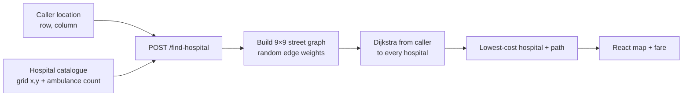
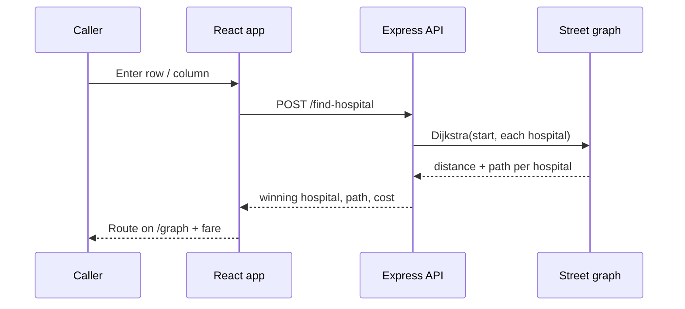

# Speedy Siren

Emergency ambulance dispatch: given a caller’s location on a city grid, find
the **nearest hospital** and the **lowest-cost route** to it, then visualize
the path. The backend runs Dijkstra on a weighted street grid; the React
frontend books the ride, estimates intra-city fare, and draws the route.

<p>
  
  
  
  
  
</p>

In a real emergency the clock starts before the wheels do. Speedy Siren
answers the first operational question: *which hospital can reach this
intersection fastest, and which streets should the ambulance take?*


---

## Why it matters

Calling a hospital and hoping an ambulance is free is a phone tree, not a
system. This project treats the city as a **weighted graph**: every block
is a node, every street is an edge with a travel cost, and hospitals sit at
known coordinates. One request returns the winning hospital, the path, and
the total cost — the same idea used in live dispatch, reduced to a demo you
can run locally.

## What it does

- **Book an ambulance** from the landing page — enter a grid row and column
  for the caller.
- **Nearest-hospital search** — Dijkstra from the caller to every hospital
  in `server/hopitals.json`; the lowest-cost destination wins.
- **Route visualization** — a graph view (`/graph`) highlights the chosen
  path on the city grid.
- **Intra-city fare estimate** — a simple cost readout for the selected
  trip.
- **Contact / WhatsApp** — a public contact path so a bystander can reach
  dispatch without installing a native app.

## How routing works





Edge weights stand in for traffic. In this demo they are sampled per run;
the algorithm is the same if those weights come from a live traffic feed.

## Architecture

```
speedy-siren-app/
├── client/                 React 18 + React Router + Bootstrap
│   ├── src/pages/Home      landing, booking, about
│   ├── src/pages/Graph     route visualization (react-graph-vis)
│   └── src/components      fare calculator, contact, WhatsApp
└── server/                 Express on port 3002
    ├── index.js            Graph + Dijkstra + /find-hospital
    └── hopitals.json       hospital name, grid cell, ambulance count
```

| Layer | Choice |
| ----- | ------ |
| UI | React 18, React Router, Bootstrap |
| Routing API | Express, CORS |
| Pathfinding | Dijkstra on an undirected weighted grid |
| Map | `react-graph-vis` |

## Quickstart

The API and the UI run as two processes.

```bash
# 1. routing API
cd speedy-siren-app/server
npm install
npm start          # http://localhost:3002

# 2. web app (second terminal)
cd speedy-siren-app/client
npm install
npm start          # http://localhost:3000
```

Open the home page, book an ambulance with a grid coordinate, then open
`/graph` to see the selected path.

`GET /test` on the API should return `{ "message": "Server is working" }`.

## Screenshots


This started as a team hackathon build. The fork keeps the original product
name and adds a project-level README so the dispatch idea is obvious from
the repo page.
